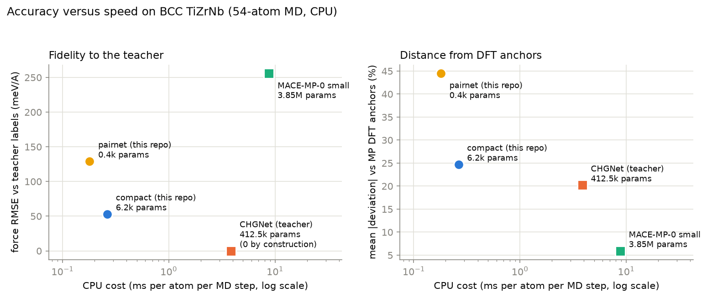

# alloy-mlip-bench

[](https://github.com/aamirmalik-dr/alloy-mlip-bench/actions/workflows/ci.yml)

Machine-learning interatomic potentials deployed as ASE calculators and
benchmarked on what they actually predict for BCC TiZrNb: a compact potential
distilled in this repository against the pretrained foundation potentials it
competes with, accuracy against speed, property by property.



Every point is measured in this repository (54-atom MD, CPU, fixed seeds).
The left panel is fidelity to the teacher's labels, where the teacher scores
zero by construction and MACE's number is model-to-model disagreement, not
error against truth. The right panel is the fair ground: mean absolute
deviation from nine Materials Project DFT anchors. It is monotone in cost.
The compact model trained here gives up 4.5 points of DFT-anchor fidelity
against its teacher and steps MD 14.6 times faster on the same CPU.

## The property benchmark at a glance

| property (anchor) | pairnet 433p | compact 6.2k | CHGNet 413k (teacher) | MACE-MP-0 3.8M | anchor |
|---|---|---|---|---|---|
| Nb a0, A (MP DFT) | 3.529 | 3.325 | 3.327 | 3.322 | 3.318 |
| Nb B0, GPa (MP DFT) | 78 | 147 | 147 | 179 | 172 |
| Nb C44, GPa (MP DFT / expt) | 66 | 22 | 3.5 | 34 | 43 / 28.7 |
| Nb vacancy Ef, eV (expt) | 0.17 | 1.58 | 1.47 | 2.91 | 2.6 to 3.1 |
| TiZrNb alpha, 1e-6/K | 38.3 | 7.8 | 6.1 | 6.6 | (none) |
| TiZrNb RDF first peak, A | 3.24 | 2.93 | 2.93 | 2.94 | (none) |
| NVE drift, meV/atom/ps (gate 1.0) | 0.0002 | 0.0003 | 0.0003 | 0.0004 | all pass |
| speed, ms/atom/MD step | 0.180 | 0.264 | 3.86 | 8.78 | |

All property values are model predictions, not experimental claims. Full
tables, protocols, and the honest failure analysis are in
[RESULTS.md](RESULTS.md); highlights worth knowing before trusting any row:

- The compact model reproduces its teacher almost everywhere (lattice
  constants to 0.02 A, RDF overlay, vacancy energetics), which means it also
  reproduces the teacher's errors: the Nb vacancy formation energy sits at
  half the experimental value in both. Distillation copies the physics you
  give it.
- The pair potential fails structurally, not statistically: its Nb C12 equals
  its C44 to half a percent, which is the Cauchy relation every central pair
  potential must obey, while real Nb has C12/C44 = 4.7. Its equilibrium
  lattice constants are 6 to 11% too large.
- A random-frame split would have claimed 2.2x better energy accuracy for the
  compact model (5.7 vs 12.6 meV/atom, 3 seeds); this repository measures
  that gap once and quotes only leakage-safe group-split numbers.

## What this repository is

- `alloybench.calculators`: one `get_calculator(name)` registry that returns
  any of the four potentials as a standard ASE calculator with energy,
  forces, and virial stress. The trained models compute both as exact
  autograd derivatives, verified against finite differences in the tests.
- `alloybench.properties`: the benchmark battery, written against the ASE
  interface only: Birch-Murnaghan EOS, finite-difference elastic constants
  with internal relaxation, RDF from NVT MD, thermal expansion from NPT MD,
  monovacancy formation with an elemental-reservoir convention, an NVE
  energy-drift gate, and an MD speed meter.
- Two potentials trained from scratch here (descriptors, models, training
  loop, periodic neighbor list all original code; foundation potentials,
  ASE, and pymatgen are pip dependencies, never vendored).
- The full benchmark record: `results/` JSONs, figures, `metrics.json`, and
  an executed tutorial notebook that walks the whole pipeline on a miniature
  dataset.

## Label and data integrity

Training labels are surrogate model labels from a pretrained universal
potential (chgnet 0.4.2, CHGNet v0.3.0 weights, BSD-3-Clause), selected over
MACE-MP-0 small by measured CPU speed in this session. They are not DFT.
Real DFT enters only as validation anchors from the Materials Project API
(CC BY 4.0; a committed literature fallback with citations covers the no-key
case), plus cited experimental values for quantities MP does not carry. See
`data/README.md` for the full provenance chain.

## Install and run

```
python -m venv .venv
.venv\Scripts\activate    # Windows; on Linux/macOS: source .venv/bin/activate
pip install torch --index-url https://download.pytorch.org/whl/cpu
pip install -e .
```

Offline demo on the committed checkpoints and sample frames (no foundation
models needed):

```
alloybench demo
python examples/md_with_compact_potential.py
```

The full benchmark needs the foundation potentials and a few hours of CPU:

```
pip install -e .[foundation,anchors]
python scripts/run_all.py
```

`pytest tests -q` runs the 52-test suite (neighbor list against ASE and
brute force, autograd forces and stress against finite differences, the
Cauchy-relation check on the elastic machinery, split leakage safety,
calculator compliance).

## Scope, honestly

This is a CPU-scale benchmark of small models on one alloy system: 54-atom
cells, teacher labels rather than DFT, one random occupancy per property, a
1,566-frame training set. It measures distillation fidelity and relative
model behavior under a matched protocol; it does not certify any potential
for production use, and the alloy-property values carry no experimental
validation. Compositions beyond the TiZrNb ternary, magnetism, defects
beyond monovacancies, and finite-size convergence are out of scope.

## Related repositories

This repository is one of four on machine-learned interatomic potentials for BCC TiZrNb. Each is standalone, imports nothing from the others, and can be cloned and run on its own. The four share the teacher choice and the split discipline (held-out generation groups and compositions) so that their numbers can be read side by side.

- [mlip-descriptor-potential](https://github.com/aamirmalik-dr/mlip-descriptor-potential): Behler-Parrinello descriptor potential for BCC TiZrNb, benchmarked against tuned linear and pair-potential baselines.
- [graph-neural-forcefield](https://github.com/aamirmalik-dr/graph-neural-forcefield): message-passing potential for BCC TiZrNb, benchmarked head to head against the descriptor approach at matched data and budget.
- [forcefield-active-learning](https://github.com/aamirmalik-dr/forcefield-active-learning): query-by-committee active learning for TiZrNb potentials, an honest label-budget benchmark against random selection.
- [pd-hydrogen-diffusion-dft](https://github.com/aamirmalik-dr/pd-hydrogen-diffusion-dft): a full density-functional calculation with CP-PAW, hydrogen diffusion in fcc palladium, the kind of reference calculation the TiZrNb repositories stand in for with surrogate labels.

## Author

Aamir Malik
GitHub: https://github.com/aamirmalik-dr
LinkedIn: https://linkedin.com/in/aamirmalik-dr

## License

MIT (see LICENSE). Foundation-potential weights are installed by their own
packages under their own licenses (chgnet BSD-3-Clause, MACE-MP-0 MIT);
Materials Project data is CC BY 4.0.
