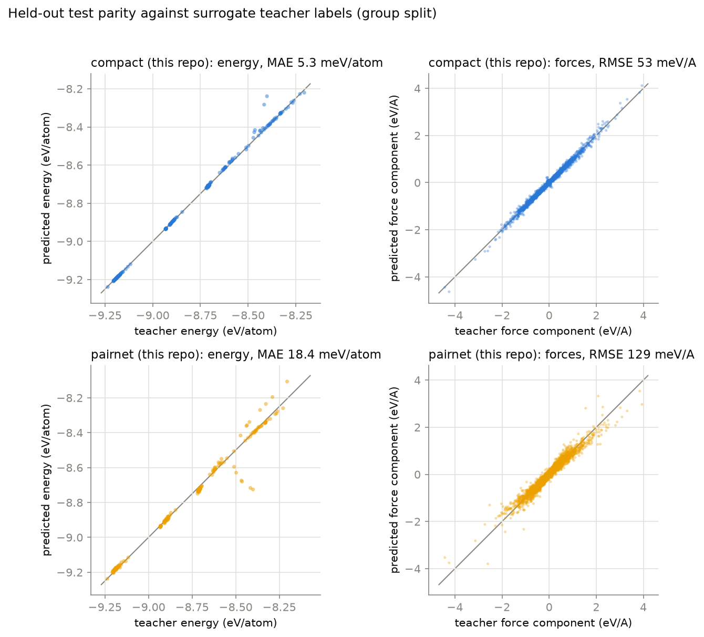
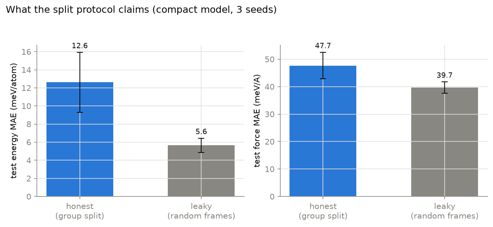
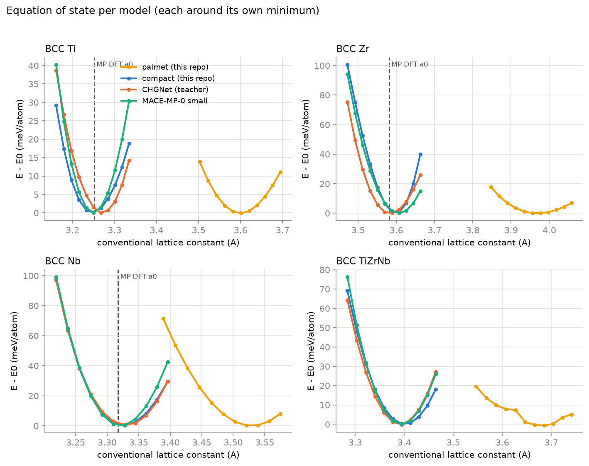
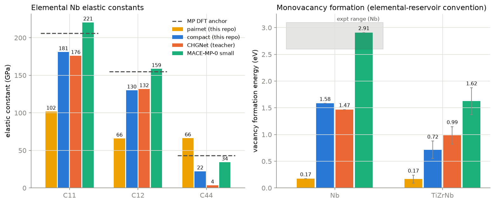
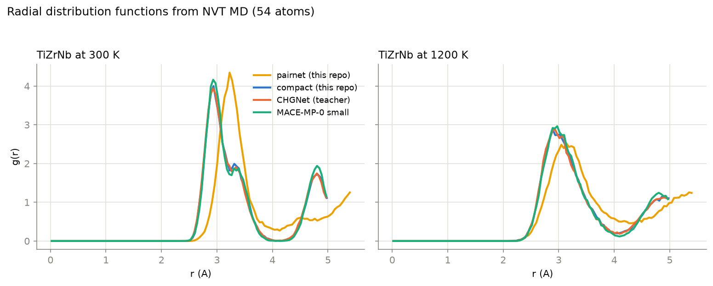
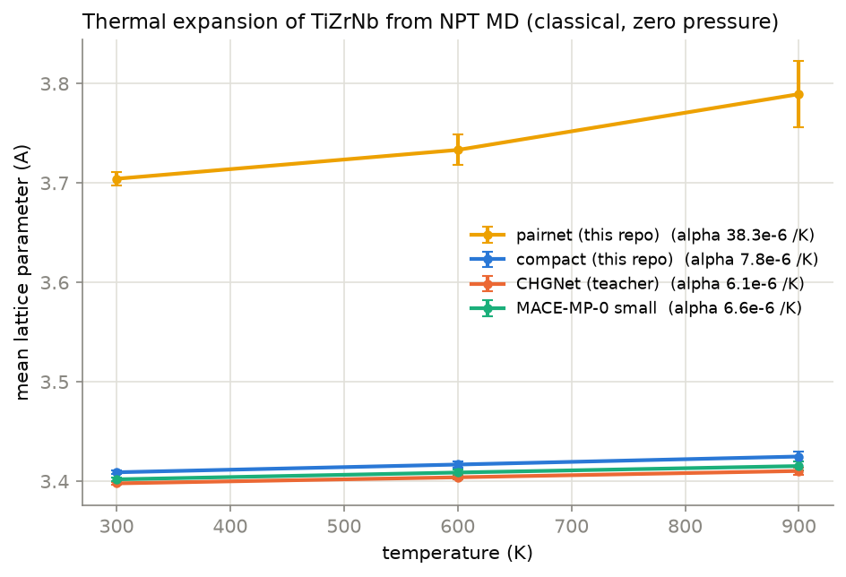
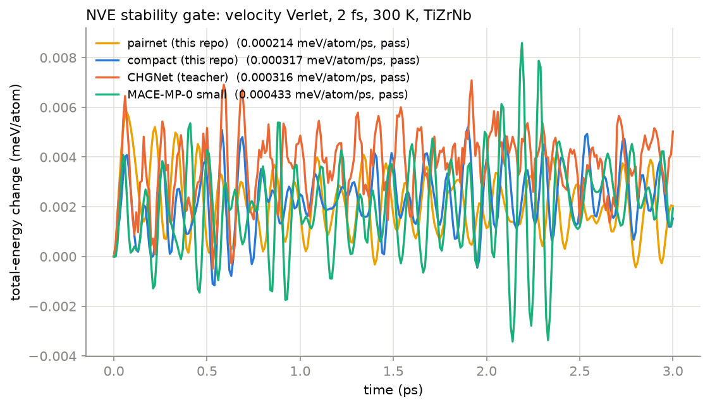

# Benchmark results

Every number on this page was measured in this repository's pipeline in a fresh
Python 3.11 virtual environment (torch 2.13.0+cpu) on one CPU (AMD Ryzen 5
5600U, 12 threads). Seeds are fixed in `configs/`; `results/metrics.json` is
the machine-readable source of all values quoted here. Wall-clock timings for
training and suite stages ran with other benchmark stages on the same machine
and are approximate; the MD speed benchmark alone was run on an otherwise idle
machine.

## What the labels are

Training labels are surrogate model labels from chgnet 0.4.2 (CHGNet v0.3.0
default pretrained weights, BSD-3-Clause), chosen over MACE-MP-0 small by
measured CPU speed (0.308 vs 0.598 s per 54-atom energy+forces call,
`data/teacher_choice.json`). They are not DFT and are never described as DFT.
Real DFT appears only as Materials Project anchors (CC BY 4.0, fetched from
the API in this session: mp-73 Ti, mp-41 Zr, mp-75 Nb, including elastic
constants), plus cited experimental values where MP has no entry.

## The four models

| model | parameters | source | role |
|---|---|---|---|
| pairnet | 433 | this repo, trained here | learned pair potential, the fast floor |
| compact | 6,243 | this repo, trained here | distilled descriptor potential, the protagonist |
| chgnet | 412,525 | pip, pretrained | the teacher |
| MACE-MP-0 small | 3,847,696 | pip, pretrained | independent foundation model |

Both trained models used the same data, the same grid ({lr 1e-3, 3e-3} x
{force weight 0.2, 1.0} screened at 25 epochs, winner retrained 80 epochs),
and the same fixed selection score on the validation split. Both grids chose
force weight 1.0 (compact lr 3e-3, pairnet lr 1e-3). Training wall time:
compact 1396 s, pairnet 539 s.

## Accuracy versus speed (the headline)

MD cost measured as real velocity-Verlet steps through the ASE interface,
54-atom BCC TiZrNb, 2 fs, 100 timed steps after warmup, idle machine:

| model | ms/atom/MD step | force RMSE vs teacher (meV/A) | mean abs deviation vs MP DFT anchors |
|---|---|---|---|
| pairnet | 0.180 | 129.1 | 44.5% |
| compact | 0.264 | 53.0 | 24.7% |
| chgnet (teacher) | 3.859 | 0 by construction | 20.2% |
| MACE-MP-0 small | 8.779 | 255.9 | 5.9% |

Read the two accuracy columns differently. Force RMSE against held-out teacher
labels measures distillation fidelity, and the teacher trivially scores zero
on it; MACE's 255.9 meV/A there is disagreement between two foundation models,
not an error against truth. The anchor column is the fair cross-model ground:
mean absolute relative deviation over the nine MP-DFT-anchored quantities (a0
and B0 for BCC Ti, Zr, Nb; C11, C12, C44 for Nb). On that column the ordering
is monotone in cost: MACE is the most DFT-faithful (5.9%) and the most
expensive; the teacher sits at 20.2%; the compact model gives up 4.5 points
against its teacher (24.7%) and repays with a 14.6x MD speedup; the pair
potential is 1.5x faster still but falls apart (44.5%).

## Fidelity to the teacher (held-out group split)



Test = 192 frames from held-out generation groups; transfer = 348 frames of
two compositions (Ti2ZrNb, TiZrNb2) never trained on.

| model | test E MAE (meV/atom) | test F MAE (meV/A) | test F RMSE | transfer E MAE | transfer F MAE | transfer F RMSE |
|---|---|---|---|---|---|---|
| compact | 5.33 | 33.6 | 53.0 | 8.61 | 56.3 | 256.1 |
| pairnet | 18.44 | 84.8 | 129.1 | 15.74 | 102.2 | 266.3 |

The compact transfer force RMSE (256 vs 56 MAE) is a heavy tail: rare large
errors on unseen compositions, not a uniform degradation. MACE-MP-0 small,
scored against the same test labels after a per-element energy offset fitted
on the validation split, disagrees with the teacher by 43.8 meV/atom and
172.6 / 255.9 meV/A (MAE/RMSE).

## Split-protocol control

Same model, same budget (30 epochs, 3 seeds), only the split protocol varies:

| protocol | test E MAE (meV/atom) | test F MAE (meV/A) |
|---|---|---|
| honest (whole generation groups, stratified) | 12.62 +/- 3.31 | 47.7 +/- 4.8 |
| leaky (random frames) | 5.65 +/- 0.80 | 39.7 +/- 2.1 |

A random-frame split would have claimed 2.2x better energies and 1.2x better
forces, with a 4x smaller seed spread. Only group-split numbers are quoted
anywhere in this repository. (The control runs at a reduced 30-epoch budget,
so its absolute values sit above the 80-epoch headline numbers; the measured
quantity is the gap.)



## Property benchmark

All values are model predictions on identical 54-atom structures (same
occupancy seeds), each model probed around its own equilibrium. Anchors: MP =
Materials Project DFT (API, this session); expt = cited experiment
(`data/anchors_literature.json`).

### Lattice constant a0 (Angstrom) and bulk modulus B0 (GPa)

| system | pairnet | compact | chgnet | MACE | MP DFT |
|---|---|---|---|---|---|
| BCC Ti a0 | 3.600 | 3.248 | 3.269 | 3.249 | 3.252 |
| BCC Zr a0 | 3.969 | 3.598 | 3.585 | 3.607 | 3.582 |
| BCC Nb a0 | 3.529 | 3.325 | 3.327 | 3.322 | 3.318 |
| TiZrNb a0 | 3.685 | 3.401 | 3.392 | 3.394 | (no anchor; Vegard 3.377) |
| BCC Ti B0 | 27 | 68 | 72 | 101 | 111 |
| BCC Zr B0 | 18 | 170 | 97 | 97 | 88 |
| BCC Nb B0 | 78 | 147 | 147 | 179 | 172 |
| TiZrNb B0 | 30 | 99 | 112 | 119 | (no anchor) |

The compact model reproduces its teacher's lattice constants to 0.02 A or
better everywhere. Its one large EOS miss is the Zr bulk modulus (170 vs the
teacher's 97 GPa); Zr remains this dataset recipe's weak spot, consistent
with the two sibling repos of this cluster. The teacher's Ti B0 error against
DFT (72 vs 111 GPa) is inherited by the compact model (68), as distillation
predicts. The pair potential misplaces every equilibrium by 6 to 11% in a0;
its EOS minima sit so far out that the scan's recentering walk (3 to 5 scans)
was needed to find them at all.



### Elastic constants (GPa), finite differences about each model's own a0

| system | constant | pairnet | compact | chgnet | MACE | MP DFT | expt (RT) |
|---|---|---|---|---|---|---|---|
| Nb | C11 | 102 | 181 | 176 | 221 | 206 | 246.5 |
| Nb | C12 | 66 | 130 | 132 | 159 | 155 | 134.5 |
| Nb | C44 | 66 | 22 | 3.5 | 34 | 43 | 28.7 |
| TiZrNb | C11 | 36 | 112 | 123 | 140 | (none) | (none) |
| TiZrNb | C12 | 27 | 92 | 106 | 108 | (none) | (none) |
| TiZrNb | C44 | 25 | 23 | 21 | 31 | (none) | (none) |

Two honest observations. First, the teacher predicts a nearly vanishing Nb
C44 (3.5 GPa versus 43 DFT / 28.7 expt); the compact model does not inherit
this one (22 GPa), since C44 probes a shear direction that the rattle-and-
strain training data apparently constrains differently, but neither value is
good. Second, pairnet's Nb C12 (65.9) equals its C44 (66.3) to within half a
percent: that is the Cauchy relation, which any central pair potential must
obey at equilibrium, and it is the cleanest possible demonstration of why a
pair potential cannot describe a BCC metal's shear response (real Nb has
C12/C44 = 4.7). The alloy TiZrNb values carry no anchor and are reported as
cross-model comparisons only. The TiZrNb cell is one 54-atom random
occupancy with internal relaxation at every strain; a production estimate
would average over several occupancies and larger cells.

### Monovacancy formation energy (eV), elemental-reservoir convention

| system | pairnet | compact | chgnet | MACE | anchor |
|---|---|---|---|---|---|
| Nb | 0.17 | 1.58 | 1.47 | 2.91 | expt 2.6 to 3.1 |
| TiZrNb (5 sites) | 0.17 +/- 0.07 | 0.72 +/- 0.16 | 0.99 +/- 0.16 | 1.62 +/- 0.25 | (none) |

Only MACE lands inside the experimental Nb range. The teacher's severe
underestimate (1.47 eV) is a known weakness of its family of potentials, and
the compact model faithfully inherits it (1.58 eV): distillation reproduces
the teacher, defects and all. 54-atom cells are small for defect energetics;
the finite-size error is shared across models by construction.



### Dynamics: RDF, thermal expansion, NVE gate

- RDF (NVT Langevin, 300 K and 1200 K): compact overlays the teacher almost
  exactly (first peak 2.93 A both, heights 4.01 vs 3.94 at 300 K); MACE is
  indistinguishable from either in peak position (2.94 A). Pairnet's first
  peak sits at 3.24 A, the expanded lattice made visible.
- Thermal expansion (NPT Berendsen, 300/600/900 K, zero pressure, classical):
  alpha = 6.1e-6 (teacher), 6.6e-6 (MACE), 7.8e-6 (compact), 38.3e-6 /K
  (pairnet). No alloy anchor exists; for scale, experimental elemental Nb is
  7.3e-6 /K near room temperature.
- NVE energy-drift gate (velocity Verlet, 2 fs, 3 ps, 300 K, gate at
  1 meV/atom/ps): all four models pass, with drifts of 0.0002 (pairnet),
  0.0003 (compact), 0.0003 (chgnet), 0.0004 (MACE) meV/atom/ps and total-
  energy fluctuations below 0.01 meV/atom. No model failed the gate in this
  benchmark.







### CPU speed (54-atom MD, idle machine)

| model | ms/step | ms/atom/step | relative to compact |
|---|---|---|---|
| pairnet | 9.7 | 0.180 | 1.5x faster |
| compact | 14.3 | 0.264 | 1.0 |
| chgnet | 208.4 | 3.859 | 14.6x slower |
| MACE-MP-0 small | 474.1 | 8.779 | 33.3x slower |

The trained models' step cost is dominated by the numpy neighbor search, not
the network forward, which is why pairnet (433 params) is only 1.5x faster
than compact (6,243 params).

## Dataset

1,566 frames, 72 generation groups, 9 compositions (2 held out), 16 to 54
atom BCC cells from rattle, strain, and teacher-MD batches (seed 20260807,
identical recipe to the sibling repos of this TiZrNb cluster). Labeling cost
0.0856 s/frame; MD generation 358 s. Split: 882 train / 144 val / 192 test /
348 transfer.

## Reproducing

```
python scripts/run_all.py
```

reruns the entire chain (teacher choice, generation, training, split control,
suite, foundation evaluation, metrics, figures). The suite resumes per
property; expect a few hours of CPU. Individual stages are documented in
`docs/api.md`.
